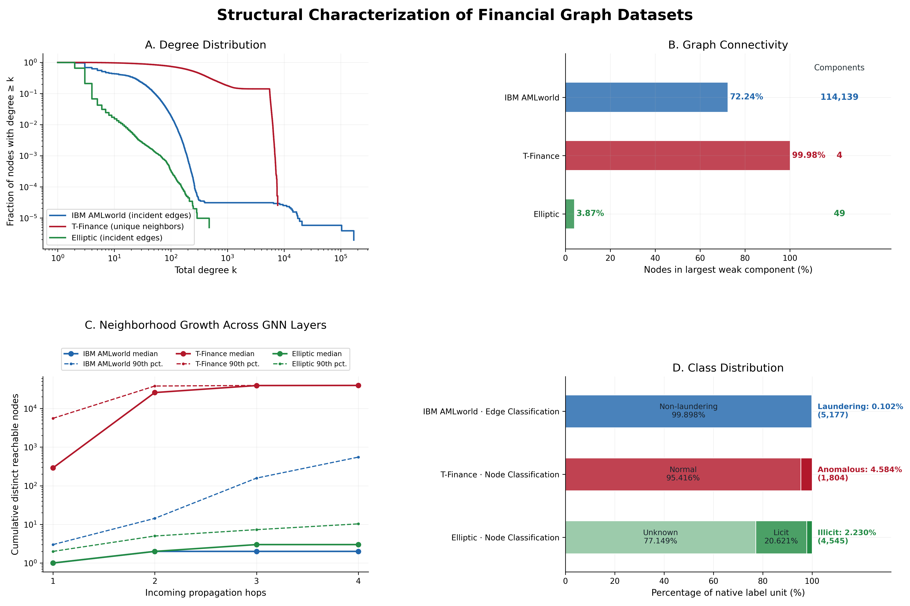

# Edge-of-Stability Dynamics in Graph Neural Networks: A Financial Graph Perspective

## Research overview

The edge-of-stability (EoS) phenomenon describes a pattern observed during gradient descent: the largest eigenvalue of the training-loss Hessian approaches and may oscillate around the stability threshold $2/\eta$, where $\eta$ is the learning rate. This behavior has been studied in fully connected and convolutional neural networks. Whether it occurs in graph neural networks (GNNs), and how graph propagation affects it, remains the question of this project.

We propose to track the largest Hessian eigenvalue throughout GNN training and compare it with $2/\eta$. Financial graphs provide several distinct graph structures and prediction tasks for examining these optimization dynamics. The financial setting is the experimental domain; the central scientific contribution sought is an understanding of EoS in GNNs.

## Main research question

**Do graph neural networks exhibit edge-of-stability dynamics during training, and how do graph-specific architectural and structural properties influence this behavior?**

## Research directions

1. **EoS occurrence in GNNs.** Monitor the largest eigenvalue of the training-loss Hessian during gradient descent to determine whether it approaches and oscillates around $2/\eta$. This establishes whether the phenomenon occurs in GNNs before examining possible causes or variations.
2. **Network depth.** Compare GNNs with different numbers of message-passing layers to study how depth affects Hessian sharpness, EoS dynamics, and training stability.
3. **Oversmoothing.** Measure how node representations become more similar with repeated propagation, then examine whether this change is associated with Hessian sharpness and EoS behavior.
4. **Graph operator normalization and graph structure.** Examine how normalization schemes affect propagation, Hessian eigenvalues, and stability. Within the same direction, study how topology—including degree distributions, connectivity, neighborhood growth, and edge direction—relates to those optimization dynamics independently of model depth.

## Preliminary datasets

- **[IBM AMLworld (HI-Small)](https://github.com/IBM/AML-Data):** A synthetic banking transaction dataset. Accounts are nodes and directed money transfers are edges. Its native task is transaction-level money-laundering detection, formulated as edge classification.
- **[T-Finance](https://github.com/squareRoot3/Rethinking-Anomaly-Detection):** A financial account relationship network. Accounts are nodes and observed account relationships are edges. Its native task is account-level anomaly detection, formulated as node classification.
- **[Elliptic Bitcoin Dataset](https://arxiv.org/abs/1908.02591):** A Bitcoin transaction network. Transactions are nodes and directed payment-flow relationships are edges. Its native task is transaction-level illicit-activity classification, formulated as node classification.

These are preliminary candidates; their suitability for the planned EoS experiments requires further validation.

## Preliminary dataset characterization

The existing figure compares degree distributions, graph connectivity, neighborhood growth across propagation layers, and native label distributions. These descriptive properties help frame dataset selection and experimental design; they do not establish EoS behavior.

